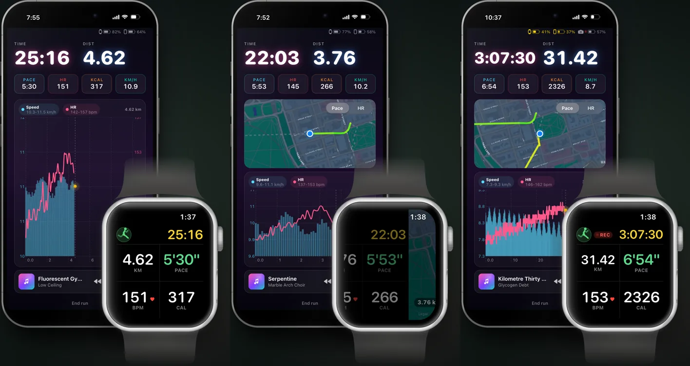

# AARC

**Alcoholics Anonymous Run Club.** A native iPhone and Apple Watch running app with AI voices in your ear: a roast-coach who reads your pace, your heart rate and the song you're listening to, a second voice who answers him, and a live agent back at **Home Base** you can talk to mid-run.

Built solo, used on every training run, and taken through a full city marathon. Site: [aarun.club](https://aarun.club). Status: private TestFlight beta (v0.8).



## AARC in a real race

A full marathon, corral to finish mat, with AARC in the ear for every kilometre: the coach, kilometre readouts from Home Base, gel and salt calls at the aid stations, a chest camera started and stopped over Bluetooth, and the runner talking back to Home Base mid-race.

[](https://www.youtube.com/watch?v=_IKXahSPCVU)

---

## What it does

**On the run**
- **The watch tracks.** `HKWorkoutSession` on the Apple Watch is the only source of pace, distance, heart rate and route; the iPhone mirrors it live. Start on the phone and the watch app opens itself. Phone-only runs work too, for treadmill and outdoors.
- **Three voices.** Ricky has a script for the run (start, every kilometre, halfway, finish) and reacts live to pace surges, heart-rate spikes, standing still and song changes. A second voice answers his lines. Home Base, the agent, calls race kilometres and answers you. Lines are written by Claude during the run and spoken with ElevenLabs, with Apple's voice as the fallback.
- **Music-aware.** It knows what's playing, jokes about the lyrics, and waits for the gap instead of talking over the chorus.
- **Orchestrated, not chatty.** A run Director owns the timeline; one priority queue paces every line; stale lines expire instead of playing late; one tap mutes everything.

**Talk back to Home Base**
- Mid-run, say **"Hey Siri, tell Home Base"**, talk, then **"Send to Home Base"** (or press the earbud, or tap Send on the watch). Your words are transcribed and reach the agent with the run and the kilometre attached.
- The agent answers out loud, in its own voice, into the run. Off a run, the answer plays on the phone and stays in the app's Home Base terminal.
- If the agent is quiet for 40 seconds, the server answers on its own so you're never left hanging.
- Home Base is any agent session with a shell (Claude Code, or your own agent). It watches the live run (pace, heart rate, battery, place) through `/live/*`, checks in every few minutes, and can push a line into your ear at any time. Start with [`scripts/home-base/`](scripts/home-base/).

**Race day**
- **Corral, then gate.** In "Actual race" mode the watch starts in the corral; one tap on the timing mat starts the race clock, so queue time never counts.
- **Course-aware.** Every voice knows where you are on the course, what's next and the next aid station. Fuel and salt are cued at the aid stations.
- **Fly dark.** A race pack of pre-rendered lines lives on the phone, so no signal never means silence; everything catches up when the network returns.
- **Camera.** A DJI Osmo Action is started, kept alive and reported on over Bluetooth, with a battery ladder for swaps.
- **Relaunch-safe.** Kill the app mid-race and it resumes the same run.

**After the run**
- **Replay.** Every run's metrics, events and spoken audio are archived (D1 + R2) and replayable on a web dashboard: pace and heart-rate chart, clickable voice timeline, debug event log.
- **Share cards.** A run becomes an image or a short video with the line's real audio and a karaoke highlight. The official race result can replace the watch numbers.
- **Voice notes.** Record how it went after the run; it's transcribed and tidied server-side.
- **Your history.** Imports past runs from Apple Health, recovers runs a crash cut short, and can import a Nike Run Club archive.

---

## Getting started

AARC is not on the App Store yet. To run it you build it yourself and bring your own backend and keys. The fastest route is to let a coding agent walk you through it: open the repo in Claude Code (or any agent) and ask it to **"set me up with the aarc-bootstrap skill"**. The skill ([`.claude/skills/aarc-bootstrap/SKILL.md`](.claude/skills/aarc-bootstrap/SKILL.md)) checks what you have, deploys your Worker, points the app at it, and interviews you to write your own coach voices.

### What you need to bring

| | Needed for | Without it |
|---|---|---|
| **iPhone (iOS 18+) and Apple Watch (watchOS 10+)** | the watch is the tracker | phone-only runs still work |
| **Mac with Xcode** and `brew install xcodegen` | building the apps | |
| **Apple Developer Program** membership | HealthKit, the watch app, Siri, Live Activity on device | a free account sideloads for 7 days with fewer capabilities |
| **Cloudflare account** for your own **Worker** | the backend: holds every key, talks to the LLM and TTS, stores runs (D1) and audio (R2) | nothing works; the free plan is enough to start |
| **Anthropic API key** (or OpenRouter) | writing every line | no coaching |
| **ElevenLabs API key** | the real voices | Apple's built-in voice |
| **OpenAI (Whisper) or Volcano Engine key** | transcribing voice notes and talk-back | talk-back by voice fails; the typed terminal works |
| **Spotify developer app** | now-playing and lyrics | music awareness is limited |
| **An agent session** (Claude Code, or any agent with a shell) | Home Base | runs work, nobody answers talk-back |
| Optional: Sentry DSN, Amap key | error reports, place names in China | |

### Your own voices

The persona prompts that make the maintainer's Ricky and second voice are **not in this repo**. It ships starter placeholders instead ([`personalities.example.ts`](proxy/src/lib/personalities.example.ts), [`jessicaDeck.example.ts`](proxy/src/lib/jessicaDeck.example.ts)); `npm install` copies them into place so a fresh clone builds and talks. The bootstrap skill interviews you (who you are as a runner, what the coach may tease you about, who the second voice is, how rough it gets) and writes your own versions, which stay gitignored.

### By hand

```sh
brew install xcodegen
cd proxy && npm install                     # also seeds the starter persona files
npx wrangler login
npx wrangler d1 create aarc-runs            # put the id in wrangler.toml
npx wrangler r2 bucket create aarc-voices
# wrangler.toml: replace the aarun.club routes with your domain, or use workers.dev
npx wrangler d1 migrations apply aarc-runs --remote
npx wrangler secret put ANTHROPIC_API_KEY   # and ELEVENLABS_API_KEY, OPENAI_API_KEY,
                                            # DEVICE_TOKEN, LIVE_DEVICE_TOKEN, LIVE_ADMIN_TOKEN
npm run deploy
```

Then point the app at your Worker: your team and bundle prefix in [`ios/project.yml`](ios/project.yml), your Worker URL in [`EndpointManager.swift`](ios/AARC/Services/EndpointManager.swift), your device tokens in `ios/AARC/Info.plist`, your Spotify Client ID in `SpotifyConfig.swift`. Then:

```sh
cd ios && xcodegen generate && open AARC.xcodeproj   # run the AARC scheme on your iPhone
```

Please don't point builds at `api.aarun.club`; that server is the maintainer's and bills the maintainer.

Hear a whole run before you go outside: Run screen, test mode, **Simulate at my desk**. Test runs never write to Apple Health.

### Home Base in two commands

```sh
export AARC_API=https://<your-worker> AARC_ADMIN_TOKEN=<your LIVE_ADMIN_TOKEN>
scripts/home-base/watch.sh                 # blocks until you talk, a run starts or ends
scripts/home-base/reply.sh "Nice split. Gel at the next table."   # spoken into the run
```

Turn on **Share live running data back home** on the Run screen. Have your agent keep one `watch.sh` running in the background and answer what it prints.

---

## Architecture

```
Apple Watch (AARCWatch)          iPhone (AARC)                       Your Cloudflare Worker
┌──────────────────────┐  WC   ┌───────────────────────────┐ HTTPS ┌───────────────────────────┐
│ HKWorkoutSession     │ ────▶ │ LiveMetricsConsumer       │ ────▶ │ /generate-script          │
│ pace / HR / route    │       │ RunDirector + ScriptEngine│       │ /dynamic-line /react-line │
│ race gate, coach page│       │ voice queue + Speaker     │       │ /tts (ElevenLabs, cached) │
└──────────────────────┘       │ race pack (offline)       │       │ /live/* /agent/*          │
                               │ Siri talk-back            │       │ D1 runs + R2 voice audio  │
                               └───────────────────────────┘       └─────────────┬─────────────┘
                                                                                 │ /live, /agent
                                                                    ┌────────────┴────────────┐
                                                                    │ Home Base agent session │
                                                                    │ watch.sh / reply.sh     │
                                                                    └─────────────────────────┘
```

- The non-negotiables (watch is the only tracker, no API keys in the app, the run works offline) are in [`AGENTS.md`](AGENTS.md).
- One Worker serves the API, the replay dashboard and the marketing site (static files in [`proxy/public/site/`](proxy/public/site/)).
- A Node port of the Worker ([`proxy/server/`](proxy/server/)) can run on a VPS as a second network path; the app fails over between endpoints automatically.

## Repo

```
aarc/
├── AGENTS.md            ground rules for AI coding agents (read first)
├── .claude/skills/      aarc-bootstrap: the guided setup
├── docs/                architecture, data model, decisions, race day, troubleshooting
├── ios/
│   ├── project.yml      xcodegen source of truth (.xcodeproj is generated)
│   ├── AARC/            iPhone app (SwiftUI)
│   ├── AARCWatch/       watch app (SwiftUI + HealthKit)
│   ├── AARCLiveActivity/
│   └── AARCKit/         shared Swift package (host-testable)
├── proxy/               Cloudflare Worker (TypeScript): API, live channel, dashboard, site
│   └── server/          Node port for a VPS
└── scripts/             build bumps, run-sim analyzer, Home Base, race video tools
```

| Layer | Choice |
|---|---|
| iOS | SwiftUI, SwiftData, AVFoundation, ActivityKit, App Intents (Siri), Swift 6 strict concurrency |
| watchOS | SwiftUI, HealthKit (`HKWorkoutSession` + `HKLiveWorkoutBuilder`) |
| LLM | Claude (Anthropic first-party, OpenRouter switchable) via the Worker |
| Voice | ElevenLabs v4 at 64 kbps or better, cached in R2; `AVSpeechSynthesizer` fallback |
| Backend | Cloudflare Worker, D1, R2; no frontend build step |
| Monitoring | Sentry (Worker and iOS) |

## Development

```sh
cd ios/AARCKit && swift test                 # shared logic on the host
cd ios && xcodebuild test -project AARC.xcodeproj -scheme AARC \
  -destination 'platform=iOS Simulator,name=iPhone 17'   # invariants + UI journeys
cd proxy && npm run dev                      # Worker on localhost:8787
cd proxy && npm run typecheck
```

Point a debug build at a local Worker with the scheme env var `AARC_API_BASE_URL=http://localhost:8787`.

**Headless QA.** The run experience is testable without leaving the desk:
- **Feedback simulator**: fast-forwards a whole run through the real generation pipeline, text only (no TTS spend). `SIMCTL_CHILD_AARC_RUN_SIM=10k xcrun simctl launch <sim> club.aarun.AARC`, then `python3 scripts/analyze-run-sim.py <transcript.json>` for an HTML report on repetition, voice balance and milestone coverage.
- **Race simulator**: `AARC_RACE_SIM` rides a whole race (corral, gate, kilometres, finish) on the simulator.
- **UI tests**: `AARCTests` asserts run-lifecycle invariants; `AARCUITests` drives start, live run, end and summary and screenshots each beat. A tripwire blocks every ElevenLabs call while tests run, so QA never bills the voice provider.

Versioning, build numbers and commit style are in [`AGENTS.md`](AGENTS.md); device gotchas in [`docs/troubleshooting.md`](docs/troubleshooting.md).

## Contributing

Issues and pull requests are welcome. Read [`AGENTS.md`](AGENTS.md) first (it applies to humans too). Never commit keys, tokens, or your persona files.

## License

[Apache License 2.0](LICENSE).
